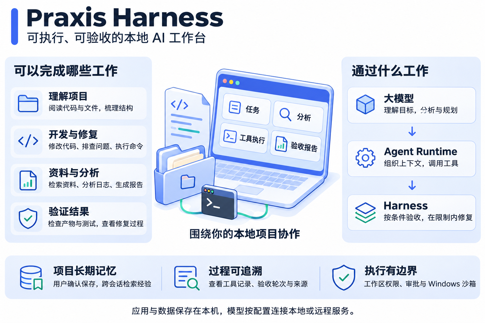
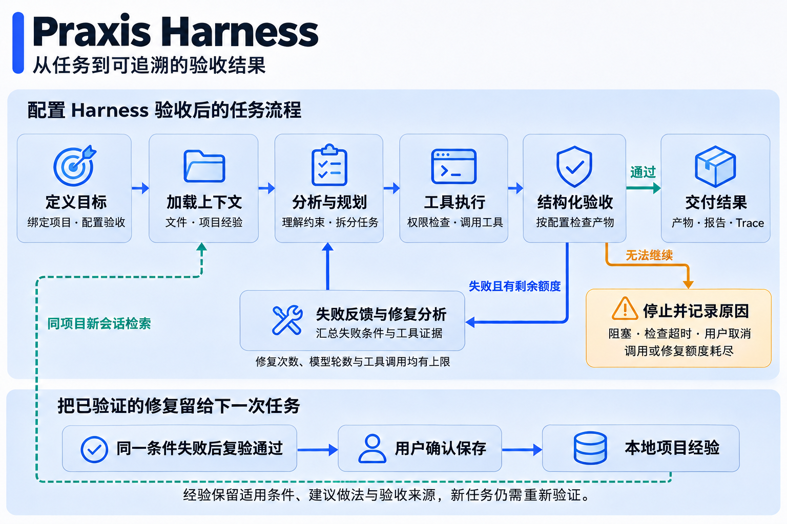
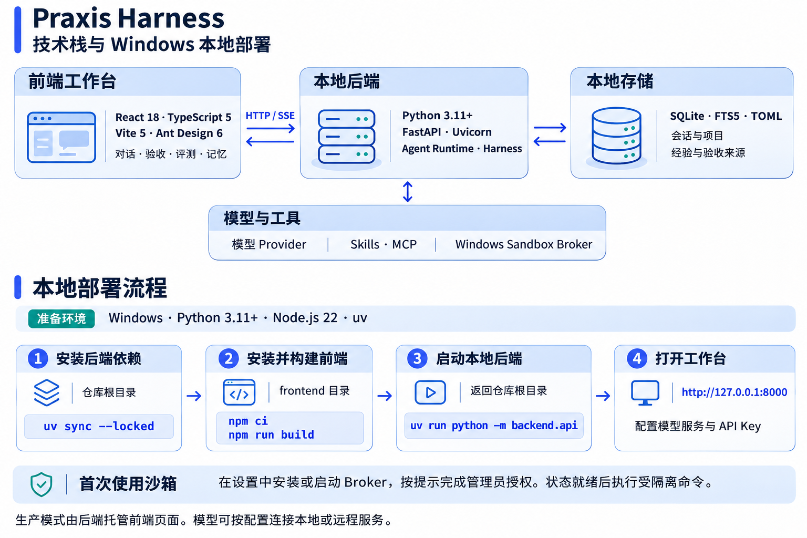

# Praxis Harness

Praxis Harness 是面向本地项目的单用户 AI Agent 工作台。你在浏览器中提出任务、选择项目和权限，Agent 可以读取文件、修改代码、执行命令。为任务配置验收条件后，运行时会实际检查工作区产物，把失败原因交给 Agent，并在指定次数内复验。每轮检查和工具记录都可以回看。



## 用一个任务理解 Harness

假设你要求 Agent 在项目中生成 `result.json`，内容为 `{"ok": true}`。在输入框的「验收」中添加 JSON 相等条件，指定文件路径、预期值和最多修复次数，然后以 Agent 模式发送任务。

1. **分析与执行**。Agent 读取相关上下文，按当前权限调用工具。希望先讨论修改方案时，可以从 Plan 模式开始。
2. **检查实际产物**。Agent 提交最终回答时，运行时重新读取并解析文件。如果文件缺失，或 `ok` 被写成字符串 `"true"`，该条件会失败。除了 JSON 相等，还可以检查文件存在、文本包含或命令退出码。
3. **根据证据修复**。只要还有修复和调用额度，Agent 就会收到失败条件与检查结果，重新分析、修改并复验。遇到权限阻塞或额度耗尽，工作台会记录停止原因。
4. **回看与复用**。从验收结果打开对应轮次的 Trace，可以检查修改使用的工具并下载报告。若同一条件先失败、下一轮复验通过，启用记忆后可以点击「保存为项目经验」，确认适用情形与建议做法。同项目的新会话可以检索这条经验，并追溯到原验收记录。



## Windows 本地启动

准备 **Python 3.11+、Node.js 22 和 uv**。在 PowerShell 中执行以下命令。构建后的前端由同一个后端进程提供。

```powershell
git clone https://github.com/Zst2001/Praxisharness.git
cd Praxisharness
uv sync --locked
cd frontend
npm ci
npm run build
cd ..
uv run python -m backend.api
```

打开 [本地工作台](http://127.0.0.1:8000)。首次使用时，在设置页填写模型服务地址、模型名称和服务所需的 API Key。需要隔离执行命令时，按沙箱设置提示安装或启动 `PraxisSandboxBroker`，完成 Windows 管理员授权并确认状态就绪。然后选择一个本地文件夹作为项目，即可开始对话。

开发前端时，保持后端运行，在另一个终端进入 `frontend` 并执行 `npm run dev`。开发页面位于 [本地 Vite 开发服务](http://127.0.0.1:5173)。



## 技术实现

| 模块 | 实现与职责 |
| --- | --- |
| 浏览器工作台 | React 18、TypeScript、Vite 和 Ant Design 提供项目对话、文件查看、验收结果与评测页面。前端通过本机 HTTP 接口提交操作，通过 SSE 接收运行事件。 |
| Agent 运行时 | Python、FastAPI 和 Uvicorn 承载会话与任务。运行时组织模型请求、工具调用和权限审批，支持用 Skills 和 MCP 扩展工作流程。 |
| Harness 验收 | 每次运行保存验收契约、逐轮报告和修复次数。模型轮数与工具调用各有上限，Trace 可按 Turn 和数据版本回看。 |
| 长期记忆 | SQLite 保存项目经验及其证据。FTS5 配合汉字双字索引支持中英文检索，按项目范围、条目状态和上下文预算选取经验。后台模型提取与整理有独立开关。 |

配置、会话和项目记忆保存在本机。模型密钥加密存储。使用远程模型时，任务需要的上下文及检索命中的经验会随请求发送到所选服务。

## 在本机复现实验

在仓库根目录执行以下命令。两项实验均可在本地运行，付费模型调用为零。

```powershell
uv run python -m benchmarks.harness --repeat 3
uv run python -m benchmarks.memory_recall
```

第一条使用脚本规划器，对照基础执行与 Harness 策略，观察失败反馈如何触发修复。第二条在固定的 24 条查询上检查记忆检索。中文组加入双字索引后，目标进入前三的查询由 **0/8** 增至 **8/8**。英文或混合组为 **8/8**，8 条无关或隔离反例的错误注入为 **0**。这些数字衡量的是这组查询的检索表现。[固定查询集](benchmarks/memory_recall_v1.json) · [逐条检索结果](benchmarks/memory_recall_results.json)

- [Harness 验收与修复](docs/harness.md)介绍条件配置、逐轮证据和经验保存方式。
- [火山引擎 DeepSeek 实验记录](docs/volcengine-integration.md)记录真实模型试跑的设置、用量与结果。
- [评测工作台](benchmarks/README.md)说明公开任务、资源准备与评分口径。
- [架构说明](docs/architecture.md)与[开发指南](docs/development.md)介绍模块边界、开发环境和故障排查。

本项目沿用 Praxis 的 [MIT 许可证](LICENSE)。
