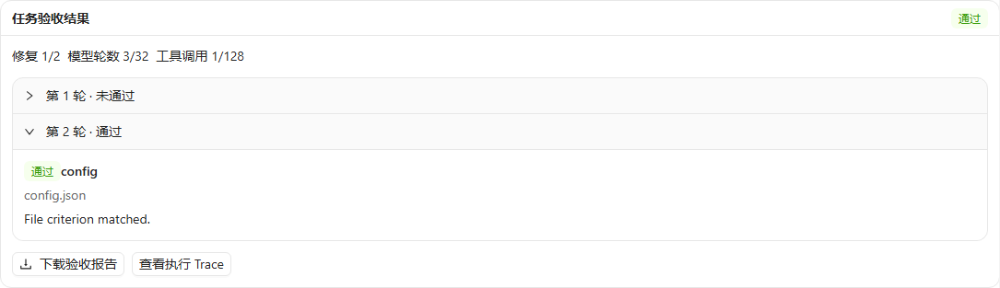

# Harness 第二阶段验证记录

本文保留第二阶段当时的环境与实现状态。后续恢复、版本基线及最新验证见 [第三阶段记录](harness-stage3-validation.md)。

日期：2026-11-03。范围：失败测试收敛、三组对照实验、独立评分、任务集、报告展示与持久化。目录仍没有 `.git`；修改前已将源码快照保存到独立临时目录用于逐文件差异核对，没有初始化仓库、创建 commit 或 push。

## 测试与检查

| 检查 | 结果 |
| --- | --- |
| 后端全量 | 1670 通过，80 按环境条件跳过，无失败 |
| 最终相关测试，包含后补的三组预算、独立评分、防误通过、报告与设置持久化 | 52 通过 |
| 前端全量 | 69 个文件，557 项通过 |
| 最终前端相关回归 | 109 项通过 |
| 前端类型检查、生产构建 | 通过；保留既有大 bundle 提示 |
| Ruff lint 与全仓格式检查 | 均通过；542 个 Python 文件格式检查通过 |

后端全量运行开始后补入的测试另通过相关测试集验证，未把相关测试数与全量测试数相加。所有模型协议集成使用本地 HTTP/SSE 服务，未调用付费模型。

## 原 14 个失败的处理

- Trace 空上下文与模式切换：对齐真实结构，消息顺序断言只选择消息项，同时保留并检查模式审计事件。
- Provider 名称：测试确认保留用户配置名称，继续规范化协议与 provider options，没有恢复名称迁移。
- MCP HTTP：loopback 不继承代理，远端服务保留代理设置。真实 HTTP 初始化、鉴权、重定向与显式坏代理测试通过。
- 两项受保护 Windows 对象测试：添加 `windows_admin` 标记并检测真实提升令牌，普通用户下明确跳过；没有放宽结果文件 ACL 或安装锁权限。
- 五个既有格式问题已修正。

默认测试通过不能证明管理员专属对象、真实已安装 Broker、Docker 和 MCP v1 环境的能力；这些项目仍按其显式环境条件运行。CI 工作流已写入仓库，但本轮没有远程运行。

## 三组与评分

- baseline、verify、repair 使用相同公开任务和预算，统一在 Runtime 入口检查模型轮数上限。
- 12 个任务覆盖配置、数据、代码和多文件一致性。独立 rubric 与脚本答案不进入真实模型上下文。
- 行为评分在任务结束后使用工作区外的脚本，通过只读沙箱执行。没有健康 Broker 时阻塞，绝不降级为宿主执行。
- 测试包含：公开条件过弱导致的内部通过/独立失败、提交代码提前退出、函数修改输入、输入文件保护、统计分母、同一提示哈希以及 JSON/Markdown 输出。
- 显式测试启动器下，脚本模式两次重复的 72 次三组执行验证完成。此启动器仅验证流程与真实子进程执行，不代表 Broker 隔离。

本机实际演示执行 `python -m benchmarks.harness --repeat 3` 共 108 次：每组 36 次，其中代码题各 9 次因 Broker 不可用而记录环境阻塞。脚本 repair 组其余 27 次通过。这是流程演示，没有真实模型 Token 数据，不能作为模型完成率提升成绩。报告提供完整 JSON、Markdown 汇总与逐次 JSONL 记录。

## 产品与真实本地交互

结果卡片展示状态、逐轮条件、失败原因、修复次数和有效预算。Chat 展示当前任务，Trace 可查看历史版本；JSON 下载不会重新执行验收。

API 测试验证最新 Runtime 槽位被覆盖后仍可从该 Turn 的 Trace 读取报告，并拒绝错误 Thread / data 版本。设置通过既有后端 view-state 保存，刷新、重开和修改其他草稿字段不会覆盖验收条件。

浏览器使用独立数据目录和显式只读 Broker 状态夹具，验证了 1365px / 390px 布局、两轮验收历史、下载 JSON、刷新后结果保留、修改设置后再次刷新及无横向溢出。夹具不执行沙箱命令，不修复或安装本机 Broker。

## 保留的边界

- 尚未运行付费服务或真实模型的正式实验；需先确定模型、版本与费用预算。
- 普通行为测试不构成抵御任意恶意提交的抗作弊裁判系统。
- Token 缺失保留为 null，P95 属于小样本描述；不生成未经测量的费用或显著性结论。
- 本阶段没有实现进程崩溃自动恢复，也没有扩展多 Agent 层级。

使用与指标口径见 [实验说明](harness-experiments.md)。
