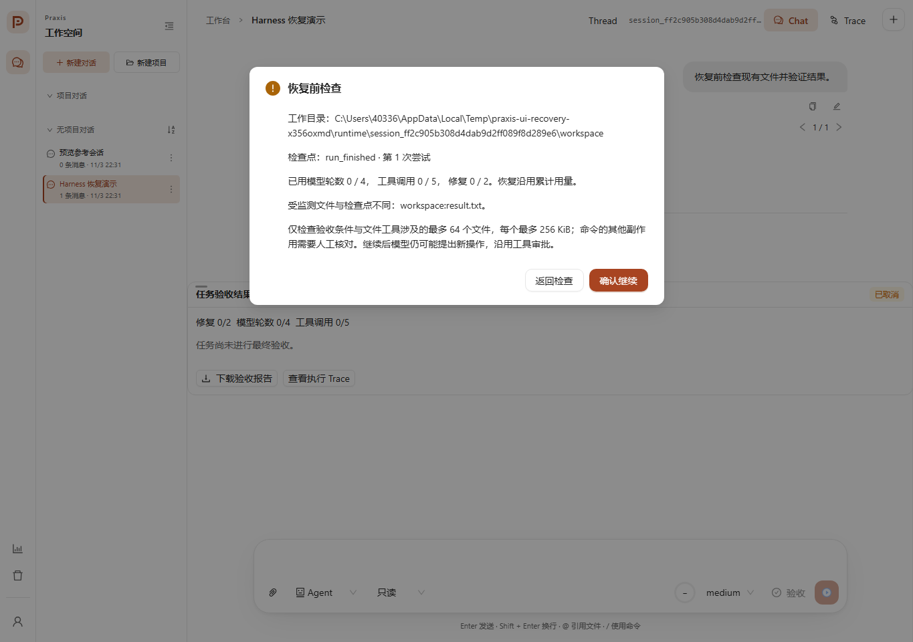

# Harness 第三阶段验证记录

最终回归日期：2026-11-04（Asia/Shanghai）。本阶段补充恢复预检、预算继承、故障注入、实验溯源和项目展示材料。用户本轮暂不提供真实模型配置与费用范围，因此没有调用外部模型服务。

后续进展：用户随后提供火山引擎服务及约 ¥10 预算，已完成 Provider 接入与 9 次文件任务真实试跑，见 [模型接入记录](volcengine-integration.md)。本页保留第三阶段原始验证范围与结果，后续付费试跑使用独立源码指纹和费用账本。

## 实现范围

- 后端发现进程中断后，将具有匹配 Runtime 的 Turn 保留为 paused，保存待定工具证据，等待用户检查后继续。
- “继续”、向暂停任务追加消息、发送队列消息均要求同一套恢复预览；接纳和执行前检查预览指纹，拒绝过期观察。
- 恢复保留工作流关联、累计模型/工具/修复用量及验收记录；新配置只能收紧该工作流的预算，新任务重新采用当前配置。
- 模型请求在网络发送前持久化计数；验收与修复事件在通知前落检查点。恢复摘要进入实际模型上下文与 Trace。
- 预检和试跑报告记录源码、提示、配置、锁文件与实验标识，支持显式选题。

## 自动检查

| 检查 | 结果 |
| --- | --- |
| 后端全量 | 1687 通过、80 按环境条件跳过、1 项浏览器等待竞态失败，见 `.pytest-stage3-complete.log` |
| 失败项修正后复测 | 三类浏览器流式场景及源码指纹测试共 4 项通过，见 `.pytest-stage3-browser-verified.log` |
| 相关定向回归 | 恢复、队列、Thread 隔离、模型请求及评测测试 65 项通过 |
| 前端全量 | 69 个文件、557 项通过，见 `frontend/.harness-stage3-ui-complete.log` |
| TypeScript / 生产构建 | 通过；保留既有的大 bundle 提示 |
| Ruff 检查 / 格式检查 | 通过，547 个文件格式符合要求 |

全量中的失败发生在故障注入浏览器脚本点击“错误详情”后等待展开内容：最终失败快照可能替换尚在流式更新的组件，使点击后的展开状态重置。脚本现先等待失败终态，再检查详情，保留文本、错误、刷新后持久化及终态断言，没有放宽超时。最后仅调整该测试等待条件和源码指纹的 JavaScript 后缀范围，按改动范围复测上述 4 项；没有将单次全量日志改写为零失败。

中间回归还发现暂停消息入口缺少新参数和旧状态断言，已修正实现及相应行为测试。中间日志保留，不作为最终通过记录。Git 输出读取现显式使用 UTF-8，修正 Windows 默认编码导致的读取线程告警。

Windows 临时 SQLite 数据使用当前用户在 C 盘的唯一临时目录。F 盘中间运行的基准 HTTP 测试曾超时；同一测试在 C 盘目录中通过，没有改变断言或扩大超时。

## 真实进程终止

`benchmarks/output/recovery-report.json` 记录四个独立 worker 被父进程终止，再重新打开 SQLite 恢复的结果：

| 场景 | 结果与证据 |
| --- | --- |
| 模型等待 | loopback HTTP 收到请求但尚未响应时终止；恢复后请求次数仍为 1，模型决策累计从 1 到 2 |
| 写入后、结果提交前 | 文件副作用只有一次，原调用标记不确定，系统不自动重放 |
| 修复事件边界 | 已消耗修复次数仍为 1，保留失败报告，重新验收后追加通过报告 |
| 用户修改文件 | 拒绝旧预览指纹，新预览显示变化，恢复后保留用户修改 |

四个场景均通过，恢复后仍沿用原来的模型轮数上限 4、工具上限 5，没有被重开时的 100 放宽。这是固定本地场景验证，不是任意任务的恢复成功率。模型等待只访问本地 HTTP 夹具，外部模型请求数为 0。

## 浏览器验证

独立临时会话使用本地脚本规划器，通过真实 API 与生产构建页面验证：1365px / 390px 恢复预览、文件变化提示、取消不发送恢复请求、确认后仅发送一次恢复请求、验收通过及刷新后结果保留。手机视口没有横向溢出，页面异常数为 0。队列和追加消息的确认由组件及真实本地 HTTP 测试补充验证。

## 版本基线与试跑

当前目录已初始化本地 Git，未创建 commit 或 remote，也未 push。最终源码基线为 `5b5112ba7ba25204e507bf5bbbb9a5b01a2133a1749f24602aea2a11755c8479`，覆盖白名单内 886 个代码、提示、构建输入与测试文件。归档 `benchmarks/output/source-5b5112ba7ba2.zip` 已逐项校验，明细与归档哈希见 `source-baseline.json`。这份归档不包含依赖环境、私人配置和构建输出，指纹范围由 `benchmarks/provenance.py` 明确定义。

`preflight.json`、`recovery-report.json`、`harness-pilot-demo.json` 与源码归档的源码指纹一致。四题脚本试跑共 12 次：每组 4 次，其中代码题每组各 1 次受环境阻塞；其余三题 repair 通过，baseline / verify 按脚本设计失败。JSON、Markdown、逐次 JSONL 均已生成。没有真实模型 Token 或成本成绩，不能将该结果写成模型成功率提升。

## 仍受环境条件限制的项目

11 月 3 日的诊断中，Broker 健康检查为 true、服务 running，但三项实际文件权限探针均在命令启动前被 `Windows audit API failed (code 2)` 阻塞。11 月 4 日最终预检发现服务状态变为 stopped，返回 `broker_service_not_running`，因此最新 `preflight.json` 将探针记录为 `not_run / broker_unhealthy`。

实现继续保持严格准入，没有关闭审计或降级为宿主命令，也未重装或重启服务。因此尚不能确认真实 Broker 隔离，命令运行中崩溃恢复也标记未运行。后续需要先恢复服务可用性，再重新定位审计初始化并验证真实准入；不根据错误码直接猜测具体缺失配置。该预检只计划检查文件权限，不覆盖网络隔离或完整安全认证。

真实模型四题试跑及 108 次完整实验等待明确服务、固定模型版本和费用范围；本轮按用户选择暂缓。使用说明见 [恢复与预检](harness-recovery.md)，简历、演示及面试表述见 [项目展示材料](project-showcase.md)。
