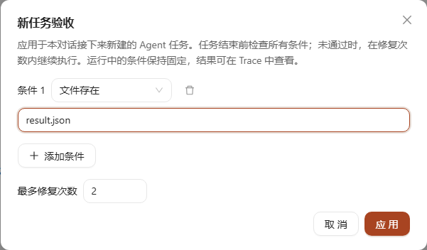
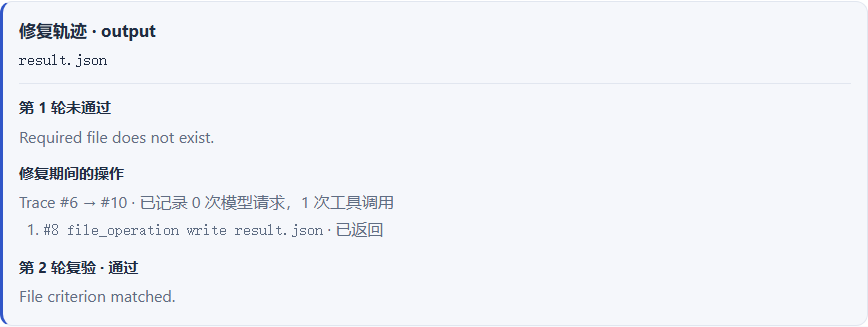

# Harness：任务验收、有限修复与对照实验

Praxis 可以为新建的 Agent 任务附加固定验收条件。模型提出最终回答后，Runtime 检查工作区产物；只有验收通过才将任务标记为完成。验收失败时，将结构化结果作为下一次模型请求的上下文，在预算内继续修复。



真实火山引擎 DeepSeek 接入、¥10 试跑预算与 9 次 trial 结果见 [模型接入记录](volcengine-integration.md)。恢复与本地验证见 [第三阶段记录](harness-stage3-validation.md)；前两阶段记录保留在 [第二阶段记录](harness-stage2-validation.md)和 [原验证记录](harness-validation.md)。

首轮实验之后的累计用量、错误诊断、请求费用关联、代码评测集与 Broker 修复进度，见 [后续实现记录](harness-next-validation.md)。

## 浏览器使用

1. 在聊天输入框工具栏点击「验收」。设置文件条件或命令，并指定最多修复次数。
2. 使用 Agent 模式发送任务。设置应用于该对话后续新建的任务；恢复已有任务沿用其保存的条件。
3. 在 Chat / Trace 的「任务验收结果」卡片查看逐轮结果、失败原因、修复次数与有效预算，并下载 JSON 报告。通过工具执行的命令仍显示审批和执行过程。
4. 在「验收」窗口选择「关闭新任务验收」可关闭后续任务的检查。

已有对话的设置使用后端界面状态存储，调整窗口宽度或刷新页面不会丢失；尚未创建对话时的草稿在新建对话后保存。已启动任务的条件与结果保存在 Runtime / SQLite / 版本化 Trace 中，后续任务不会覆盖历史报告。不为 Subagent 提供配置入口，也不支持在任务运行中修改验收条件。

## 从一条失败条件回看修复

在「任务验收结果 → 最新检查」里，曾经失败的条件会显示「追踪修复」。即使它最终通过，点击一次也能打开对应 Turn 和数据版本的 Trace。面板按失败轮次列出原始检查详情、期间的工具操作，以及同一条件在下一轮的检查结果。

可以用 `json_equals` 理解这三段证据。假设条件 `output` 要求 `result.json` 的内容等于 `{"ok": true}`。第一次检查时文件缺失，报告会记录缺失原因。若 Agent 随后通过 `file_operation` 写入文件，工具记录会给出操作、目标路径和返回状态。到第二次检查时，验收器会重新读取并解析文件，报告中的 `output` 才能变为通过。在仓库根目录运行下面的命令，可以用本地测试 planner 重现文件从缺失到通过的过程。

```powershell
uv run python -m pytest -q tests/test_acceptance.py::test_failure_feedback_repairs_real_file_and_roundtrips_state
```

下图来自隔离本地会话中的浏览器实测。测试 planner 直接决定写文件，所以修复区间记录了 0 次模型请求、1 次工具调用。



阅读代码时可以沿着两个编号查。条件 ID 跨轮关联失败和复验报告，工具的 `call_id` 关联同一次调用及其返回，包括并行工具按不同顺序完成的情况。修复统计从 `acceptance_repair` 开始，到下一轮 `acceptance_checking` 截止，因此验收器自己运行的命令归入检查阶段。面板显示这段时间记录的模型请求数和工具调用数；同轮多个失败条件共享这些操作。只有下一轮报告中的同一条件能给出复验结果。

历史实验也有一个可手工核对的例子。拓扑排序任务的 `public` 条件首次检查退出码为 1，修复时 Agent 读取实现与公开检查，并写入 `solution.py`；第二轮同一条件退出码为 0。以下文件来自当时的评测归档，可以离线阅读。[首次检查](../benchmarks/output/volcengine-rounds-repair.evidence/0c371022cfd848cab5cded07fb2a4f1d/topo-order/2-repair/rounds/01/acceptance.json) · [工具记录](../benchmarks/output/volcengine-rounds-repair.evidence/0c371022cfd848cab5cded07fb2a4f1d/topo-order/2-repair/rounds/02/tools.json) · [实际代码差异](../benchmarks/output/volcengine-rounds-repair.evidence/0c371022cfd848cab5cded07fb2a4f1d/topo-order/2-repair/rounds/02/diff.patch) · [复验结果](../benchmarks/output/volcengine-rounds-repair.evidence/0c371022cfd848cab5cded07fb2a4f1d/topo-order/2-repair/rounds/02/acceptance.json)

## 让新会话找回项目的修复经验

1. 打开「用户设置 → 记忆」，开启「启用记忆」。仅使用本地保存和检索时，可以关闭「允许后台模型提取与整理」。已有安装如果曾开启记忆，升级后会沿用原来的提取设置。
2. 打开项目对话，从「任务验收结果 → 追踪修复」进入某一条件的轨迹。在同一条件由失败到下一轮通过的位置点击「保存为项目经验」，填写适用情形与建议做法并确认。例如，条件要求 JSON 中的开关值为布尔类型时，可以记录“写入布尔值 true，使用 JSON 相等检查覆盖字符串与布尔值的差异”。
3. 在同一项目开新对话，改用“配置开关怎样输出布尔值？”提问。命中时，经验和历史验收来源一起进入当次模型请求。使用远程聊天模型会把这些内容发送给该模型。新任务仍按自己的条件验收。
4. 在设置页的条目列表选择项目，可试搜、查看证据、下载对应版本的原始验收报告，以及禁用、删除或恢复经验。

后端用会话绑定确定项目，从指定 Turn 版本的 Runtime 事件与验收报告核对条件 ID、契约指纹、修复区间及相邻轮次。正文取自用户确认的两个字段。默认数据库 `~/.praxis/memories/memory.db` 在一次事务中保存流程记忆、来源和证据，重复提交相同经验会返回同一条。后台整理只处理模型生成的候选与条目。

SQLite 默认分词器会将连续的汉字视作一个词元。Praxis 保留原有英文与代码标识符，并给连续汉字额外建立重叠双字索引。“拓扑排序”也可以通过“拓扑”和“排序”命中。从 v1 升级时会从已有条目重建 FTS5 索引，v2 已有该索引。升级在本机事务内完成，中途失败会回滚。排序和注入仍受项目范围、条目状态及上下文预算约束。[SQLite 分词规则](https://www.sqlite.org/fts5.html#unicode61_tokenizer)

v3 用本地指纹记录每个项目、每个会话版本已经处理到哪条消息。切换到较短的版本时，从第一次变化的位置重新判断提取条件。切回已经处理过的历史会跳过相同内容。旧版只记录了末条消息的标识，首次核对相符时会以当前历史建立指纹。整理开始与提交结果时都会核对条目状态，在途任务遇到禁用或删除会放弃旧结果。

手动取消提取、模型服务或额度不可用、达到重试上限时，自动扫描会跳过这份输入。可在记忆设置中手动重试，或在会话内容变化后由后台重新判断。

| 冻结的离线对照 | 原索引 | 含双字索引 |
| --- | ---: | ---: |
| 中文查询，目标进入前三 | 0/8 | 8/8 |
| 英文或混合查询，目标进入前三 | 8/8 | 8/8 |
| 无关、跨项目或无效条目，错误注入数 | 0/8 | 0/8 |

这 24 条人工用例衡量检索行为。端到端测试在隔离项目中暂停并恢复真实修复，六次并发保存得到同一条经验。重启后端后，本地 HTTP 模拟模型收到五次普通聊天请求。保存后和恢复后的两次请求包含经验，跨项目、禁用和删除时的三次请求均排除了这条经验。整个测试中的后台模型调用数为零。[固定条目和查询](../benchmarks/memory_recall_v1.json) · [旧索引逐条前三](../benchmarks/memory_recall_baseline.json) · [新索引逐条前三](../benchmarks/memory_recall_results.json)

```powershell
uv run python -m benchmarks.memory_recall
uv run python -m pytest -q tests/test_project_experiences.py
```

## 条件与结果

| 条件 | 判定 |
| --- | --- |
| `file_exists` | 范围内的普通文件存在 |
| `file_contains` | UTF-8 文件包含指定的字面文本，不使用正则表达式 |
| `json_equals` | 解析后的完整 JSON 与预期内容匹配，忽略对象键顺序；区分布尔与数值类型 |
| `command` | 通过现有 `run_command` / `write_stdin` 工具执行命令，以实际退出码判断 |

路径复用 `ScopedPaths` 的 workspace / project 边界与链接检查；文本和 JSON 每次读取最多 1 MiB。命令沿用配置的终端语法，仍受原有权限、审批、沙箱、输出限制和取消机制约束。Broker 不可用时返回阻塞，不降级为宿主执行。命令超时后终止相关作业。

验收汇总结果为 `passed`、`failed`、`blocked`、`cancelled` 或 `budget_exhausted`。规则未满足可触发修复；权限拒绝、路径越界、沙箱不可用和检查超时等阻塞不自动重试。阻塞或取消后，后续条件不再执行，报告只包含已检查的条件。

## 有限修复循环

默认最多修复 2 次，允许 0～5 次；因此默认最多进行 3 轮最终验收。修复期内还限制模型决策轮数和工具调用次数，默认分别为 32 和 128。模型调用内部仍沿用已有 transport 重试上限。命令的启动与轮询也计入工具预算，预算耗尽时取消仍在运行的验收命令。

`max_repairs=0` 表示检查后直接给出结果，不进入修复。修复次数用尽、模型轮数或工具预算耗尽时任务失败，不能仅凭模型的「已完成」文本将其标为成功。

合同由用户请求提供，没有可修改它的模型工具。模型可看到条件及最新报告，但命令输出始终视为不可信数据。规则、报告和修复次数随 `RunState` 序列化；现有恢复逻辑保留这些数据和累计预算，本阶段没有新增进程崩溃自动恢复机制。

验收只能证明所选规则成立。例如，文件包含文本不等于内容完全正确，命令退出码为零也不能证明验收脚本本身没有缺陷。正式能力评测仍需执行阶段之外的独立评分。

## API / Python

`POST /api/turns` 在原有创建请求上增加可选的 `acceptance` 字段：

```json
{
  "checks": [
    {"id": "result", "kind": "json_equals", "path": "result.json", "expected": {"ok": true}},
    {"id": "tests", "kind": "command", "cmd": "python -m pytest -q", "timeout_seconds": 30}
  ],
  "max_repairs": 2,
  "max_model_turns": 32,
  "max_tool_calls": 128
}
```

上例是 `acceptance` 的值；原有 `session_id`、`thread_id`、`message` 和权限字段保持必填或原有默认。浏览器调用仍使用现有窗口操作协议与 Origin 校验。

条件最多 16 条，ID 必须唯一。多余字段、未知条件类型、无效预算和 Plan 模式合同返回 422。没有合同的任务沿用原执行流程。

Python 嵌入可使用 `AcceptanceContract.model_validate(...)`，并通过 `AgentRunner.new_runtime(task=..., acceptance=contract)` 传入，再调用 `runner.run(runtime)`。

事件为 `acceptance_started`、`acceptance_checked`、`acceptance_repair`。验收结果放在事件的 `report` 中，避免与通用 Runtime 事件的 `status` 混淆。Trace 保留合同摘要与逐轮证据。

`GET /api/turns/{turn_id}/acceptance` 使用 `session_id`、`thread_id` 和 `data_idx` 精确读取版本化报告；在路径末尾增加 `/export` 下载 JSON。读取接口不会重跑验收命令。最终验收快照随 `run_finished` 审计事件保存，后续任务占用最新 Runtime 槽位后仍可查看。

## 对照评测

从仓库根目录运行不调用模型的流程演示：

```powershell
uv run python -m benchmarks.harness --repeat 3
```

默认输出 `benchmarks/output/harness-report.json`。报告明确标记 `mode=scripted_demo` 和 `capability_score=false`。脚本规划器被刻意设置为先提前结束、收到失败反馈后修改文件，用来验收循环是否工作；其通过率不能写成真实模型能力提升。

已配置的火山引擎 Provider 使用 [付费试跑入口](volcengine-integration.md#入口与产物)，直接读取本地加密凭据并共享费用账本。其他真实模型实验可以显式指定已有格式的模型 TOML：

```powershell
uv run python -m benchmarks.harness --config C:\path\to\model.toml --repeat 3 --output benchmarks/output/harness-model-report.json
```

这会调用配置的服务，可能产生费用。当前固定的 12 个本地任务用于流程与小规模实验，不能替代公开能力基准；模型和环境配置应在正式实验中保持一致。

当前默认清单升级为 12 个本地工程任务，每个 task × repeat 都运行 baseline、verify、repair 三组，使用相同公开要求、初始文件、工具集合及模型决策/工具预算，并轮换执行顺序。verify 仅检查、失败即停止；repair 允许有限反馈修复。每次使用新的临时工作区、Planner、Client 与 Runtime，关闭 Skills 和记忆注入，不加载用户项目。

执行结束后，由独立的精确文件、JSON、输入保留检查或沙箱 Python 行为测试评分，最终评分结果不反馈给任何一组。评分脚本在 Agent 退出后生成，位于其工作区之外；代码题要求健康 Broker，不可用时记录环境阻塞。所有执行仍通过工具与沙箱，不允许宿主执行降级。真实模型不会获得 `rubric` 或 `demo_outputs`。

输出包括 JSON 完整报告、Markdown 汇总和逐次刷新写入的 JSONL 记录，包含套件/公开提示哈希、模型摘要、预算、逐项结果、耗时、模型/工具次数与 Token 使用量。演示模式没有真实 Token 用量，不据此估计成本。指标、评分边界及真实实验准备见 [实验说明](harness-experiments.md)。

## 验证入口

命令完整性、验收额度预留和预算边界的确定性收尾见 [预算收尾与策略对照](harness-budget-finish.md)。该策略在原总工具额度内运行，独立评分仍保留。

资源准入诊断、公开命令分片聚合，以及两组都获得一次复查机会的反馈对照见 [本阶段记录](harness-feedback-control.md)。新协议与原端到端三组、固定候选条件修复分别统计。

每轮检查前的候选、公开反馈关联、按轮离线重评分和两题条件修复专项见 [逐轮证据与修复评测](harness-rounds-validation.md)。专项与正常端到端三组评测使用不同协议标识，结果分开统计。

候选源码证据包、逐 case 独立评分、零模型调用重评分和 `merge-layers` 公开验收 V2 见 [本轮实现与验证](harness-evidence-validation.md)。CLI 默认在报告旁保留 `.evidence` 目录，精确重评分需要原套件及完整、未脱敏的候选证据。

新增恢复预检、真实进程终止测试、源码指纹与四题试跑入口，见 [恢复与实验预检](harness-recovery.md)；本轮结果与限制见 [第三阶段验证](harness-stage3-validation.md)。项目演示及简历材料见 [展示材料](project-showcase.md)。

```powershell
uv run python -m pytest -q tests/test_acceptance.py tests/test_harness_evaluation.py
cd frontend
npm run typecheck
npm test -- --run src/pages/chat/AcceptanceSettings.test.tsx src/api/conversations/chat.test.ts
npm run build
```

后端覆盖真实文件修复、JSON 类型、越界、超大文件、预算与取消、真实命令退出码和超时，以及本地模型 HTTP/SSE 和 Turn API 到 SQLite 的完整链路。命令接入测试使用明确的测试启动器运行真实子进程，用于验证执行和取消，不代表 Windows Broker 隔离复测。所有自动验证均不调用付费模型。
