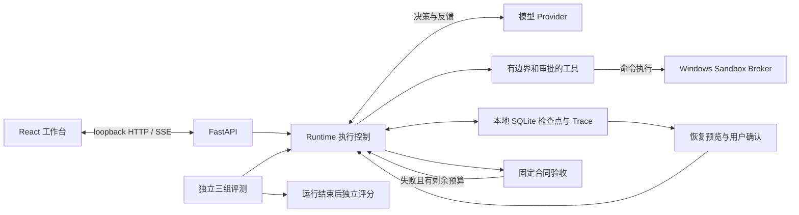

# Praxis：AI Agent 实习项目展示材料

## 项目定位

建议名称：**Praxis：具备结构化验收与中断恢复的本地 Agent 工作台**。

核心问题是“模型认为完成”与“交付物满足要求”之间的差距，以及工具产生副作用后进程退出导致的恢复歧义。展示重点放在执行控制、验证证据、资源边界和评测方法，而不是页面数量。

最新补充：在同一工具总额度内预留验收调用，达到 Agent 预算边界时以固定规则收尾，并持久化阶段用量、收尾原因和调用关联。通过同初始反馈的两组实验区分预算策略影响，详见 [预算收尾与验证](harness-budget-finish.md)；真实效果以报告为准。

技术栈：Python、FastAPI、SQLite、React、TypeScript、HTTP/SSE、MCP；Runtime 负责控制流程，模型负责选择工具和生成内容。浏览器只访问 loopback API。

验收控制执行是否能结束，独立评分用于评测结果。恢复沿用同一工作流的合同与累计用量，不重新发放预算。

## 简历表述

以下为可使用的技术描述，请按实际承担的开发范围调整：

> **Praxis 本地 Agent 工作台｜AI Agent / 大模型应用开发**  
> 围绕任务执行可靠性完善 Agent Harness：定义文件、JSON 和命令等结构化验收合同，将检查证据反馈给模型执行有限修复，并统一控制模型、工具与修复预算。  
> 基于 SQLite 检查点实现中断恢复预检，保留工作流尝试关联和累计用量；对结果不确定的工具禁止自动重放，通过文件指纹与用户确认降低恢复时重复操作、覆盖外部修改的风险。  
> 构建覆盖配置、数据、代码修复和多文件一致性的 12 题评测集，对比 baseline、仅验收和反馈修复三组，使用独立评分与逐次实验记录；补充四类真实进程终止恢复测试及前端可视化验收报告。

这段没有填写真实模型完成率、成本降幅或公开榜单成绩。免费脚本演示只能证明流程，不能转写成“任务成功率提升 X%”。四类故障测试属于固定本地场景，也不代表任意任务或外部系统的恢复成功率。

仓库包含原有 LICENSE 与历史工程内容。应保留来源和许可证，按真实职责说明独立设计、重构和新增模块；没有证据时不写“全部从零原创”。

## 三分钟演示

1. 展示一个要求生成正确 JSON 文件的任务与固定验收条件，说明条件由用户确定。展示错误产物被拦截、反馈修复、最终逐项通过和 JSON 报告。
2. 展示恢复预览中的预算、结果不确定工具及文件变化。点击“返回检查”证明不会继续执行，再确认恢复，展示同一工作流的下一次尝试和累计预算。
3. 打开评测报告，比较三组设置、独立评分和阻塞次数，明确标注当前结果来自脚本。运行 `python -m benchmarks.recovery` 展示真实终止进程的恢复证据。

若本机 Broker 命令准入仍被审计初始化阻塞，演示文件/JSON 检查并展示阻塞原因，不将测试启动器冒充为真实隔离。

## 面试案例与回答依据

**为什么不能让模型自己判断完成？** 自述没有可重复的判定依据。固定合同控制结束条件，独立评分再检验公开规则是否过弱。以“文件存在但 JSON 内容错误”为例，两者可能给出不同结果。

**为什么要限制修复？** 反馈循环有额外延迟和费用，且可能反复尝试无效动作。模型、工具和修复次数分别计量，恢复后累计，不把重启当成新额度。

**崩溃后如何避免重复写入？** 在工具启动前记录调用，缺少结果时标记不确定并禁止自动重放；恢复前观察当前文件、展示差异并确认。对外部不可撤销操作没有通用 exactly-once 保证，需要工具自己的幂等接口或人工核对。

**怎样证明 Harness 有用？** 同题、同初始文件、同工具及预算运行三组，使用不进入模型上下文的独立评分，保留所有失败与阻塞。真实文件和代码试跑已记录服务超时、工具预算耗尽以及公开验收的误接受。当前没有真实反馈修复收益证据；应讨论执行控制和评测如何揭示问题，而不能写成成功率提升。原始证据见 [接入记录](volcengine-integration.md)和 [代码评测记录](harness-code-evaluation.md)。

**目前还有什么限制？** 文件观察是有数量与大小上限的明确路径集合；恢复不能锁住其他编辑器；普通代码行为评分不等于抗恶意提交的裁判。预检分别报告 Broker 服务状态与真实准入；当前文件权限和正常输出读回探针通过，网络隔离、完整隔离认证及命令运行中崩溃恢复仍未单独验证。

后续已修复服务停止等待、审计初始化和正常输出的访问权限，真实文件权限探针及代码参考解通过。DeepSeek 代码题 6 次试跑中记录了 3 次公开验收通过但独立边界检查失败，实际反馈修复仍未触发。可用来讨论验收覆盖和误接受，不能写成修复成功率提升；细节见 [代码评测记录](harness-code-evaluation.md)。

实现及复现入口见 [恢复说明](harness-recovery.md)、[评测方法](harness-experiments.md) 和 [第三阶段验证记录](harness-stage3-validation.md)。不要把整个既有仓库的测试总数当成本轮新增测试数量。

新增可展示的评测能力：每次试验保留有界候选源码、文件差异和工具阶段摘要，独立评分提供逐 case 失败类型，并支持不调用模型的真实沙箱重评分。`merge-layers` 公开验收 V2 补上深层 null 删除和两个输入不可变性的覆盖；原独立 rubric 保持一致。实现、证据边界和本次对照原始记录见 [证据与 V2 验证](harness-evidence-validation.md)。可在面试中打开失败候选、预期/实际结果，再重评分复现；不要把单题小样本当作整体能力提升。

最新已补齐检查前逐轮候选、公开反馈、轮间差异与独立 case 状态迁移。对两份固定失败候选各做两次真实模型反馈修复，最终产物四次均通过，流程完成两次；另两次因工具预算耗尽而保留执行失败。演示时可选择拓扑排序案例展示失败 → 反馈 → 文件修改 → 验收与独立评分通过，再展示金额分配案例解释产物正确与流程完成的区别。专项口径和端到端回归分开，见 [逐轮证据与真实修复评测](harness-rounds-validation.md)。

后续新增资源等待原因诊断、遗弃许可回收、公开命令输出聚合及等机会复查对照。可展示“产物正确，但执行因资源采样错误阻塞”的证据链，以及免费重评分如何区分代码与环境问题。原中断批次不能用于宣称反馈成功率提升，见 [等机会反馈对照](harness-feedback-control.md)。

修复后完整的两题 × 三次 × 两组对照中，feedback 执行完成 6/6、retry 5/6，最终产物均 6/6 通过；另一次 retry 耗尽工具预算。可展示等机会实验设计和预算对流程完成的影响。结果仅限两份固定候选，不写成普遍成功率或代码正确率提升，原中断批次保持独立。
